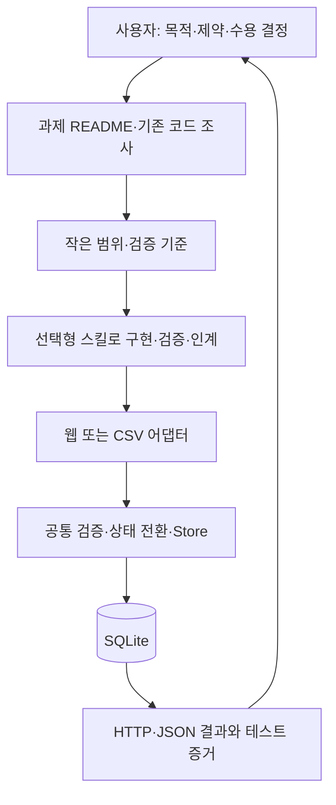

# 구조·재사용·한계

## Bootstrap 데이터 흐름

`start.sh` → POSIX `install.sh --start` → 확인된 Python 3.10+의 `tools/start.py` → 기존 `tools/install.py`의 plan/apply_plan → 과제 루트에서 `codex` → 허용 모델 선택 → 최초 지시 1회. 정확한 현장 허용 ID를 `--model`로 명시한 경우에만 `codex --model ID [PROMPT]`로 자동 전달한다.
PowerShell은 같은 Python 파일을 직접 실행한다. `start.ps1`은 선택 래퍼이며 정책 변경 없이만 사용한다.

현재 README 폴더를 우선하며, 없으면 조상(첫 Git 경계까지)과 바로 아래 README 폴더만 본다. 하네스 내부는 제외하고, 모호하면 번호/경로 선택 또는 `--target`으로 명시한다. 직접 설치도 기존 README가 있어야 한다. 전체 홈 디렉터리를 재귀 검색하지 않는다. `git --no-optional-locks status`로 Git index 캐시도 갱신하지 않는다.
시작 로직은 계획 출력 후 기존 설치기를 호출한다. 기존 installer의 preview 기본값은 유지한다. 실패 시 Codex를 시작하지 않고, 정상 I/O 예외는 이번에 만든 파일만 rollback한다. 빈 디렉터리·강제 종료의 부분 파일은 남을 수 있다. 기존 파일은 업데이트하지 않는다.
CLI는 `--help`의 대화형 `[PROMPT]` 지원을 확인하고 원래 터미널을 상속한다. `codex exec`로 바꾸거나 승인·보안·모델 설정을 변경하지 않는다. Windows npm 배치 진입점은 프롬프트를 cmd 문자열에 넣지 않고 같은 npm Node 진입점을 직접 실행한다. CLI 도움말·인자 전달과 실제 AI/Skill 인식은 별도 검증이다.
Python 없음은 원본 AGENTS와 START를 읽는 채팅 문장으로 대체한다. 이미 실행 중인 세션·비대화형 터미널은 중첩 실행하지 않는다. 8개 Skill 이름·기존 예제 코어는 유지한다.

Builder는 구현을 지속하고 Reviewer는 P2/P4/P5~P6/P7의 중요한 범위를 읽기 전용으로 감사한다. 실제 지원/현장 허용이 없으면 현재 세션 순차 검토라고 표시한다. `templates/REVIEW.md`가 지원 확인·별도 세션·결과 처리 절차, `templates/FINAL_REVIEW.md`가 코딩 종료 전 설명 보고서 형식이다. 설치기는 templates를 그대로 복사하며 기존 기록은 덮어쓰지 않는다. 실제 협업·사용자 결정·리뷰 반영은 STATUS/DECISIONS에서 커밋·파일·검증에 연결한다. 보고서 자동 작성은 Codex 운영 지침이며 시험 서술형 답변 프로그램이 아니다.

아래는 개발 중 재사용할 선택형 도구와 예제 구조다.

하네스는 “답안을 대신 정하는 엔진”이 아니라 사용자가 결정한 문제를 작은 실행 흐름으로 만들고 증거를 남기는 도구 상자다.
과제 README가 주문서, AGENTS가 작업 원칙, 스킬이 작업별 안내서, 공통 코어가 검증·저장 도구, 어댑터가 입력 번역기 역할을 한다.
기존 앱이 있으면 그 앱의 도구를 사용한다. Python 예제를 넣으려고 기존 프레임워크를 교체하지 않는다.

## 파일과 책임

| 계층 | 파일 | 책임·경계 |
|---|---|---|
| Core 운영 | AGENTS.md | 범위·권한·검증·시험 제한. 자동 집행하는 보안 시스템은 아님 |
| Workflow | skills/*/SKILL.md | 발굴·합의·구현·검증·감사·인계·리뷰·전달. 필요할 때만 읽기 |
| Capability | fde/records.py | 스키마 검증, 허용 상태 전환, SQLite 원자 저장·조회·집계 |
| Adapter | examples/web.py | HTTP 입력·오류 코드·UI 제공. 도메인별 화면 언어는 web.html |
| Adapter | examples/batch.py | name/stage CSV를 title/status로 변환, JSON 출력 |
| Example | examples/data/archive.csv | 합성 자료 보관 데이터. 실제 시험·고객 정보 없음 |
| Installer | tools/install.py, install.sh | preview·없는 파일 추가·경로 검사. Git/CLI 설정 수정 없음 |
| Evidence | tests, docs/VERIFICATION.md | 성공 기준·실패 조건과 실제 실행 결과 |

## 두 가지 실제 흐름

웹: 사용자가 등록 → `POST /api/items` JSON → `validate_record` → `Store.add_many` 트랜잭션 → SQLite → 201 JSON → 화면 갱신.
검색은 허용된 정렬 컬럼과 바인딩 파라미터로 쿼리한다. `%`와 `_`도 문자 그대로 검색한다.
상태 변경은 `open → active → done`만 허용한다. `BEGIN IMMEDIATE`로 읽기·판정·쓰기를 한 트랜잭션에 묶어 동시 요청의 잘못된 이중 전환을 막는다.

비웹: CSV 전체 검사(1 MB·1000행 이하) → 어댑터가 `queued/processing/complete`를 상태로 변환 → 같은 `validate_record`·`Store.add_many` → 일괄 commit 또는 rollback.
export는 별도 명령이다. DB import와 파일 export를 하나의 원자 작업이라고 주장하지 않는다. export는 100개씩 끝까지 읽고 JSON에 레코드·집계를 담는다.
출력 파일이 있으면 오류를 내고 보존한다. import를 반복하면 중복 레코드가 추가된다.

## 무엇을 어떤 형태로 재사용하는가

| 필요 | 선택 | 새 과제에서 할 일 |
|---|---|---|
| 입력 검증·상태·간단 조회·저장 | 작은 코드 예제 | 의미가 맞을 때 fde 코어 사용. 다른 스키마면 필요한 부분만 옮기고 경계 테스트 변경 |
| CRUD·검색·정렬·필터·페이지 | 구현 패턴 | 예제에는 생성·조회·상태 갱신이 있다. 제목 수정·삭제는 필요할 때만 구현 |
| 사용자·역할·승인 | 설계 패턴 | 주체/행동/대상 권한표, 거부 테스트, 승인 전후 상태와 감사 기록부터 정의. 구현 제공 아님 |
| API 연동·오류·로그 | 어댑터 패턴 | 입력/출력 스키마, timeout, 오류 유형, 실제 연동과 Mock 증거를 분리. 비멱등 쓰기 자동 재시도 금지 |
| 가져오기·내보내기·집계 | 실행 코드 | CSV adapter와 JSON export, summary. 파일 한계·중복 정책을 도메인 기준으로 결정 |
| 보고서·대시보드 | 예제+패턴 | 현재 UI는 상태 집계만. 새 지표는 계산·데이터 원천·검증부터 추가 |
| 발굴·구현·검증·인계 | Skill | 필요한 스킬만. 단순 변경에 문서·인터뷰 추가 안 함 |
| 진행 상태·운용 | 템플릿·가이드 | STATUS 골격 복사, 실제 사실만 기록 |

범용성은 산업 이름의 개수가 아니라 입력·업무 규칙·입출력 매체의 경계를 바꾸는 비용으로 평가한다.
새 어댑터는 코어가 기대하는 dict를 만들거나 기존 프로젝트의 검증 경계를 사용한다. 공통 레지스트리나 상속 계층을 추가할 필요는 없다.

## 산업 × 문제 유형 × 구현 형태

다음은 적용 설계 예시이며, 실행 검증은 수리 웹·자료 CSV 두 유형만 수행했다.

| 산업·업무 | 문제 유형 | 구현 형태 | 재사용 / 새로 확인할 것 |
|---|---|---|---|
| 제조 설비 점검 | 기존 서비스 수정 | 백엔드 API | 재현·상태 테스트 / 설비 코드·현장 상태 규칙 |
| 물류 출고 정산 | 데이터 정제 | 배치 파이프라인 | CSV 원자 저장 / 단위·중복·재처리 키 |
| 금융 거래 분석 | 집계·리포팅 | CLI·분석 보고서 | 검증·집계 패턴 / 금액 Decimal·접근 권한·규정 |
| 유통 상품 관리 | 신규 서비스 | 풀스택 | 검색·페이지 / 재고 동시성·가격 규칙 |
| 교육 수강 명단 | 업무 자동화 | 관리 웹 | 입력·가져오기 / 학생 식별·개인정보 |
| 의료 예약 연계 | 시스템 통합 | API+Mock | 어댑터 경계 / 동의·권한·실제 병원 API |
| 인사 승인 요청 | 승인 워크플로 | 기존 시스템 확장 | 상태·거부 테스트 / 역할·감사·기밀성 |
| 공공 신청 | 신규 양식 | 프론트엔드 | 수용 기준·검증 패턴 / 접근성·필수 문서 |
| 게임 대회 운영 | 장애·오류 수정 | 기존 코드 | 재현·최소 수정·회귀 / 대진 규칙 |
| 미디어 보관 | 수집·정제 | CSV CLI | 실제 batch 예제 / 업무용 중복 정책 |
| 에너지 계측 | 예약 집계 | 배치·대시보드 | 스키마·집계 / 시각·누락·센서 단위 |
| 연구 데이터 | 성능 개선 | 스크립트·시뮬레이션 | 측정·회귀 / 재현 seed·데이터 크기 |
| 목록 밖 산업 | 조사 후 선택 | 지정 형태 | 작업 절차 / 해당 도메인 불변조건 |

규제 산업은 관할 규정과 운영 요건을 별도 확인한다. 템플릿 사용이 규제 준수를 보장하지 않는다.
연결할 수 없는 장비·API는 인터페이스와 Mock으로만 검증하고 실제 운영 검증을 남긴다.

## 기존 하네스의 판단

| 질문 | 관찰·조치 |
|---|---|
| 잘 해결한 것 | 증거 후 완료 주장, 문제 하나에 집중, 상태·인계, 결정론 코어 원칙 유지 |
| 범용성 제한 | 모든 작업 P1~P7·인터뷰·수치 합의 강제 → 작업 규모별 선택 |
| 과도한 자동화 | Git identity 자동 설정·강제 인계·커밋 → 제거. 실패 코드 보존과 커밋 분리 |
| 중복 | README·AGENTS·스킬에 반복된 고정 일정 → QUICKSTART의 시간 계획과 각 파일 역할로 정리 |
| 호환성·보안 | AGENTS 자동 덧붙임·GUIDE 덮어쓰기 → preview·보존·링크 거부. 임의 스킬 경로 복제 우회 제거 |
| 유지·변경 선택 | 8개 스킬 이름과 핵심 원칙 유지. 설치기 교체, 실행 코어·회귀 검증 추가 |

## 알려진 한계

- HTTP 서버는 표준 라이브러리의 단일 처리 연습 서버다. 인증·역할·TLS·rate limit·운영 관측이 없다. 실제 서비스 배포용이 아니다.
- JSON 본문 16 KiB, 제목 200자, 상태 3개. 새로운 규칙을 이 구조에 억지로 맞추지 않는다.
- SQLite 파일은 예제 전용 경로를 사용한다. 기존 업무 DB에 그대로 연결하거나 자동 마이그레이션하지 않는다.
- import 중복 제거, 대규모 스트리밍, export의 여러 쿼리 간 일관된 snapshot은 구현하지 않았다. 동시 변경 중 export·summary는 다른 시점일 수 있다.
- 설치는 기존 버전을 자동 업데이트하지 않는다. 링크·junction을 거부하지만 악의적 동시 파일시스템 변경에 대한 보안 경계는 아니다. 쓰기 도중 디스크 오류면 일부 새 파일이 남을 수 있으며 재실행으로 없는 파일을 채운다.
- 브라우저 실제 버튼 조작, Cofa 미리보기·제공 모델·시험 정책, 사용자 이해도는 별도 확인 대상이다.
