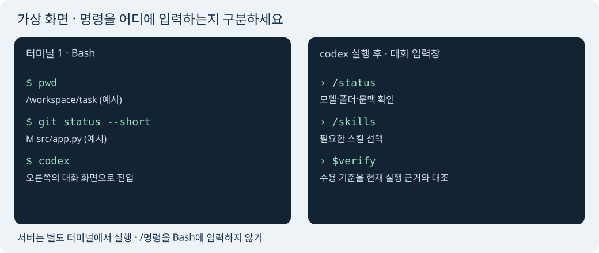

# 직접 운용하는 매뉴얼

읽는 순서: [빠른 시작](QUICKSTART.md) → 이 문서의 입력 위치·한 흐름 실습 → [구조](ARCHITECTURE.md) → [35분 모의시험](SIMULATION.md).
용어가 대부분 낯설면 [처음 쓰는 사람 설명](BASICS.md)부터 읽는다. 긴 실습·모의시험은 선택 사항이다.
문서의 **가상 출력**은 화면 모양을 설명하기 위한 예시다. 이번 실제 결과는 [검증 기록](VERIFICATION.md), 공식 지원 근거는 [SOURCES](SOURCES.md)에 있다.

## 1. Bash와 Codex 입력창



`$` 프롬프트가 있는 Bash는 운영체제 명령을 받는다. 예제에 적힌 맨 앞 `$`는 입력하지 않는다.
`codex`를 실행한 뒤 나오는 대화 입력창은 자연어·`/명령`·`$스킬이름`을 받는다. Codex 입력창에서 `$`는 스킬 호출의 일부다.
서버 터미널은 별도로 둔다. 서버를 종료하는 Ctrl+C와 Codex 작업을 중단하는 키를 혼동하지 않는다.
아래 Bash 예제는 Cofa용이다. Windows PowerShell은 `Get-Location`, `Get-Content README.md`로 대응하며 Python·Git 명령은 같다.

## 2. 명령별 실습 카드

표의 출력은 모두 **가상 출력**이다. 실제 문구와 메뉴는 제공 버전마다 다르다.

| 입력 위치·목적 | 입력할 내용 | 가상 출력 | 정상 판정 | 오류 대응 |
|---|---|---|---|---|
| Bash·폴더 확인 | `pwd` | `/workspace/task` | 과제 루트 | 다른 위치면 지정 폴더로 `cd` |
| Bash·파일 탐색 | `rg --files` | `README.md`, `src/app.py` | 필요한 파일·진입점 확인 | rg 없으면 `find . -maxdepth 2 -type f`, 대형 의존성 폴더 제외 |
| Bash·요구사항 읽기 | `cat README.md` | 지정 실행·필수 기능 | 지정 경로·제출물 파악 | 파일 없으면 과제 안내 위치 확인, 요구사항 추측 금지 |
| Bash·버전 확인 | `codex --version` | `codex-cli <버전>` | 제공 CLI 존재 | command not found면 제공 터미널 확인·운영 안내 요청. 임의 업데이트 금지 |
| Bash·시작 | `codex` | Codex 대화 화면 | 현재 과제 폴더로 시작 | 로그인·권한 문제는 제공 환경 안내 따름. 개인 키 사용 금지 |
| Codex·상태 | `/status` | model·directory·context 정보 | 폴더·허용 모델 일치 | `/` 목록 확인. 없으면 화면 표시와 읽기 전용 CLI help 사용 |
| Codex·모델 | `/model` | 사용 가능 모델 목록 | 허용 목록 안에서 선택 | 없는 모델명 강제 입력 금지. 제공 모델 사용 |
| Bash·모델 지정 시작 | `codex --model gpt-6.1-sol` | 선택한 모델로 시작 | 계정·시험에서 허용될 때만 | 모델 미제공이면 기본 `codex` 후 제공 목록 확인 |
| Codex·스킬 목록 | `/skills` | discover·verify 등 | 필요한 스킬 표시 | `.agents/skills` 경로 확인, 재시작 또는 파일 직접 읽기 |
| Codex·스킬 사용 | `$build-slice 검색 조건 검증만 구현해` | 작은 범위·변경·테스트 결과 | 요청 범위만 진행 | `원본하네스/skills/build-slice/SKILL.md를 읽고 수행해`로 대체 |
| Bash·Git 상태 | `git status --short` | ` M src/app.py` | 내 변경·기존 변경 구분 | 저장소가 아니면 지정 프로젝트 위치 확인. 자동 git init 금지 |
| Bash·변경 확인 | `git diff` | 수정 전후 줄 | 범위 밖 변경 없음 | 새 파일은 diff에 안 나올 수 있으므로 status와 직접 열기 병행 |
| 서버 Bash·웹 실행 | `python -m examples.web --db .run/repairs.sqlite3 --port 8000` | `Listening on 0.0.0.0:8000` | 오류 없이 실제 포트 출력 | 점유된 포트의 기존 서버 확인, 임의 kill 금지. 필요하면 허용 포트 하나를 새로 선택 |
| IDE Browser·미리보기 | 출력 포트 `8000`, 경로 `/` | 수리 접수 화면 | 등록·검색·처리·완료·새로고침 | Cofa 포트 전달·서버 터미널·바인딩 확인. UI 위치는 현장 안내 |
| Bash·서버 HTTP 확인 | `curl http://localhost:8000/health` | `{"status": "ok"}` | 200과 JSON | curl 없으면 IDE Browser로 `/health`. 서버 로그의 실제 포트 확인 |
| Bash·관련 테스트 | `python -m unittest discover -s tests -p test_core.py -v` | 테스트 이름과 `OK` | 실패·ERROR 없음, skip 확인 | 첫 실패의 기대/실제 입력 확인, 같은 실패 반복 2회면 가설부터 |
| Codex·리뷰 | `/review` | 검토 범위 선택·지적 | 파일:줄·재현·영향이 있는 지적 | 없으면 `$cross-review` 또는 “수정 없이 변경 diff 검토해” |
| Bash·CLI 리뷰 | `codex review --uncommitted` | 변경 검토 결과 | 제공 CLI·모델에서 허용 | help에 옵션이 없으면 자연어 리뷰. 별도 모델 호출 비용 감안 |
| Codex·인계 보존 | `$handoff` | HANDOFF와 다음 행동 | 실패·사용자 변경까지 사실대로 기록 | 스킬 없으면 같은 내용을 문서로 직접 요청 |
| Codex·압축 | `/compact` | 요약 후 대화 지속 | 상태·제약·다음 일 유지 | 중요한 상태를 먼저 파일로 보존. 지원 안 하면 짧은 범위로 지속하거나 새 세션 |
| Codex·새 세션 | `/new` | 새 대화 | 기존 파일 상태 유지 | 명령 없으면 Codex 종료 후 `codex`. 인계 먼저 |
| Bash·세션 재개 | `codex resume` | 저장 세션 선택 | 프로젝트·원하는 세션 일치 | 다른 세션을 선택하지 말고 ID·폴더 확인. 저장 기록 없으면 새 세션+Handoff |
| Bash·가장 최근 재개 | `codex resume --last` | 최근 세션 재개 | 마지막 세션이 원하는 작업일 때만 | 다중 세션이면 picker 사용 |
| Codex·짧은 옆질문 | `/side 이 결정의 위험을 짧게 설명해` | 별도 임시 대화 | 주 작업 상태를 확인하며 사용 | 없으면 주 세션에서 질문. 중요한 결정은 주 세션·파일에 반영 |
| Codex·중단 | 실행 중 Esc 또는 제공 중단 키 | 현재 작업 정지 | 진행 명령·diff 확인 | 키 동작은 버전별 확인. 서버 탭의 Ctrl+C는 서버 종료 |

현재 프로젝트의 테스트 명령이 있으면 예제 명령 대신 그것을 사용한다. 위 테이블의 문법 존재와 기능별 현장 허용은 다른 판단이다.

## 3. 웹과 비웹을 직접 실행

하네스 원본 저장소에서 실행하거나, `--with-examples`로 설치한 `.harness/kit`로 이동한다.
네트워크 패키지 설치·API 키는 필요 없다. Python 3.10+와 SQLite 모듈이 필요하다.

웹: 서버 카드의 명령을 별도 터미널에서 실행한다. “자전거 브레이크 조정” 등록 → “브레이크” 검색 → 처리 시작 → 완료 처리 → 새로고침한다.
정상은 레코드가 유지되고 접수·처리·완료 집계가 바뀌는 것이다. 빈 제목은 저장되지 않아야 한다.
브라우저 미리보기가 없어도 HTTP·CLI 테스트는 가능하다. 화면 조작 검증은 미검증으로 남긴다.

비웹 Bash:

```bash
python -m examples.batch import examples/data/archive.csv --db .run/archive.sqlite3
python -m examples.batch export --db .run/archive.sqlite3 --output .run/archive-report.json
cat .run/archive-report.json
```

**가상 출력**: 첫 명령 `{"imported": 3}`. JSON은 세 레코드와 `open:1, active:1, done:1` 집계를 담는다.
이미 가져온 DB면 행 수는 늘어난다. 기존 보고서가 있으면 export는 종료 코드 2로 보존한다. 새 경로를 선택한다.
입력 헤더는 `name,stage`, 단계는 queued/processing/complete다. 오류가 한 행이라도 있으면 이번 import 전체가 반영되지 않는다.
빈 데이터(헤더만)는 0행 정상, 잘못된 헤더는 오류다. 1 MB·1000행 제한을 넘으면 조용히 자르지 않고 거부한다.

예제 HTTP 계약:

| 요청 | 입력 | 기대 결과 |
|---|---|---|
| GET `/api/items` | q, status, order=id/title, limit=1..100, offset>=0 | `{"items": [...]}` |
| POST `/api/items` | JSON title, 선택 status | 생성 201, 잘못된 입력 400 |
| PATCH `/api/items/양의ID` | `{"status":"active"}` 또는 done | 성공 200, 불가 전환 409, 없는 ID 404 |
| GET `/api/summary` | 없음 | 상태별 건수 |
| GET `/health` | 없음 | 상태 ok |

입력 경계는 프론트엔드만 믿지 않는다. HTTP와 CSV가 같은 검증·저장 코드를 호출한다.

## 4. 도구를 언제 선택하는가

| 도구 | 역할·장점 | 비용·단점 | 사용 시점 / 대안 |
|---|---|---|---|
| AGENTS.md | 오래 유지할 프로젝트 원칙 | 길거나 충돌하면 실행 혼란 | 규칙·경계 / 현재 지시로 짧게 설명 |
| Skill | 반복 작업의 선택형 절차 | 잘못된 트리거·오래된 절차 | 특정 작업 반복 / SKILL.md 직접 읽기·자연어 |
| MCP | 기존 서비스 도구·데이터 연결 | 권한·전송·인증·장애 | 실제 데이터가 필요하고 허용될 때 / 파일·계약·Mock |
| Plugin | 스킬·연결 기능의 배포 단위 | 설치·권한·의존성 관리 | 팀 배포 이점이 있을 때 / 로컬 스킬 폴더 |
| Hook | 특정 이벤트에 고정 자동화 | 숨은 실행·중복·루프·검토 비용 | 반복 실수가 증명됐을 때 / 테스트 명령 직접 실행 |
| Subagent | 독립 조사·리뷰 위임 | 토큰·문맥 전달·편집 충돌 | 독립 작업이 충분히 크고 요청·허용됐을 때 / 주 세션 순차 작업 |
| Side chat | 주 흐름 옆의 짧은 질문 | 중요 결정이 본문에 안 남을 수 있음 | 용어·대안 확인 / 주 세션에서 질문 |
| Review | 변경의 실제 결함 점검 | 모델 비용, 오류를 놓칠 수 있음 | 위험 변경·최종 전달 / 직접 diff·관련 테스트 |
| Handoff | 사실·미완료·다음 행동 보존 | 오래되면 잘못된 재개 | 중단·담당자 변경·압축 전 / 짧은 STATUS 갱신 |

이 저장소는 MCP·Hook·Plugin 설정 파일을 만들지 않는다. 선택 기능이 없어도 코어·테스트·문서 읽기가 동작한다.
일반 개발 환경에서 필요가 생기면 효과·기존 대안·설정 비용·토큰/시간·오류/보안·fallback을 먼저 비교한다.
예: 반복 lint 누락이 실제로 확인되면 외부 전송 없는 로컬 검사 Hook을 별도 검토할 수 있다. 시험 중에는 설정을 추가하거나 신뢰 검토를 우회하지 않는다.
MCP의 읽기 도구도 데이터가 외부로 나갈 수 있다. 현장 제한은 공식 기능 존재보다 먼저 확인한다.

## 5. 모델·시간·토큰을 직접 감독

제공 목록에 Sol 6.1이 있으면 일반 분석·구현의 시작점으로 선택한다. 좁고 명확한 조사에는 허용된 Luna, 다른 모델은 현장 목록과 문제 특성으로 판단한다.
Terra 5.6의 정확한 모델 식별자는 추정하지 말고 `/model`의 실제 목록을 사용한다. Astra는 사용자 시험 안내상 제한 대상이다.
reasoning effort는 명확한 작업은 보통, 복잡한 설계·검증은 높여 선택하되 계정·현장 지원과 남은 예산을 확인한다. 모든 작업에 최고 effort를 고정하지 않는다.
모델이 실패하면 동일 요청을 무한 반복하지 않는다. 입력과 재현을 줄이고, 테스트로 원인을 구분한 뒤 필요할 때 모델을 바꾼다.

로그 전체를 매번 붙이지 말고 첫 오류와 재현 입력을 전달한다. 관련 파일만 rg로 찾고, 긴 상태는 문서로 남긴다.
별도 리뷰어는 작성자의 가정을 줄일 때 가치가 있다. 읽을 범위·수정 금지·보고 형식을 정하고 최종 판단은 PM과 메인 세션이 한다.
마감이 가까우면 선택 기능·UI 꾸밈·추가 자동화를 줄이고 핵심 입력→저장→출력과 제출물을 지킨다.

## 6. 중단·수정·재개·컨텍스트

방향을 바꾸는 Codex 입력 예시:

```text
현재 구현을 멈춰. 검색 개선보다 CSV 잘못된 행의 전체 거부를 우선한다.
현재 git 상태·진행 명령·테스트 결과를 보존하고 변경 영향과 다음 작은 계획을 정리해.
기존 사용자 변경을 건드리지 말고 영향받는 코드와 테스트만 수정한 뒤 재개해.
```

정상 흐름: 실행 중인 작업 확인 → diff 보존 → 우선순위·기준 변경 기록 → 영향 경로만 수정 → 관련 검증 → 다음 slice.
실패 테스트가 남으면 Handoff에 테스트 이름·명령·실제 결과를 적는다. 인계만을 위해 실패 코드를 커밋하지 않는다.

컨텍스트가 부담되면 `$handoff`로 상태를 파일에 저장하고 `/compact`를 쓴다. P2/P5나 임의 잔여 비율마다 새 세션을 만들지 않는다.
새 세션이 필요하면 README·AGENTS·Handoff·STATUS를 읽게 한 뒤 `git status`와 기록 환경을 확인한다.
`resume`은 대화 기록 복원이다. 디스크 파일·실행 중 서버·테스트 통과를 되돌려 주는 기능으로 취급하지 않는다.

## 7. 용어를 실제 판단에 사용

| 용어 | 이 하네스에서 실제 쓰는 문장 |
|---|---|
| Acceptance Criteria·수용 기준 | “잘못된 CSV 한 행이 있으면 기존 DB 행 수가 그대로다.” 테스트로 판정한다 |
| Vertical Slice·세로 흐름 | “등록 UI→입력 검사→DB→목록 표시”를 한 번에 작동시키고 다음 흐름으로 간다 |
| Critical Path·필수 경로 | 입력·저장·결과가 막히면 제출 가치를 잃는다. 테마 변경보다 먼저 해결한다 |
| Scope Management·범위 관리 | 로그인 요구가 없으면 이번 연습에 추가하지 않는다. 새 요구는 포기할 항목과 함께 결정한다 |
| Risk-based Testing·위험별 검증 | 문구는 해당 UI, DB 쓰기는 rollback·동시성·기존 데이터 보존까지 확인한다 |
| Regression Testing·회귀 검증 | 입력 오류를 고쳤으면 정상 CSV와 기존 웹 저장도 깨지지 않았는지 확인한다 |
| Context Management·문맥 관리 | 현재 기준·실패·다음 행동을 남기고 로그·중복 탐색을 줄인다 |
| Graceful Degradation·기능 없는 대안 | Skill 미인식이면 파일 읽기, clone 실패면 직접 지시, API 불가면 Mock·미검증 표시 |
| Architecture Decision·구조 결정 | SQLite 선택 이유와 버린 외부 DB의 비용을 DECISIONS에 남긴다 |
| Handoff·인계 | 새 담당자가 “어디까지 됐나”를 추측하지 않도록 실제 코드·테스트·다음 명령을 적는다 |

## 8. 설명과 이해도 확인

PM이 직접 답하고 실행한 뒤 체크한다. AI가 대신 체크하지 않는다.

- [ ] Bash 명령 두 개와 Codex 입력 두 개를 구분해 직접 사용했다.
- [ ] 레코드 하나가 웹/CSV에서 같은 검증·DB 코드를 통과하는 경로를 설명했다.
- [ ] 실패한 입력과 관련 테스트 결과를 보고 성공 주장 하나를 거절할 수 있다.
- [ ] 계획을 중단·축소하고 저장된 상태에서 재개했다.
- [ ] MCP·Hook·Subagent를 지금 쓰지 않아도 되는 이유와 유용해지는 조건을 말했다.
- [ ] 인증 부재·중복 import·동시 export snapshot 한계 중 둘을 파일·함수와 연결했다.

결과 설명 틀: 결론 → 파일·함수와 선택 이유 → 실제 검증 → 약점·다음 검증.
예: “검증·저장을 HTTP와 분리했다. fde/records.py의 Store를 웹과 배치가 함께 쓴다. 같은 DB를 HTTP로 변경 후 CLI로 export하는 테스트가 있다. 다만 export snapshot과 인증은 추가 설계가 필요하다.”
실제 시험의 AI 금지 후속 문항은 사용자 혼자 수행한다. 이 자료는 사전 학습용이다.
